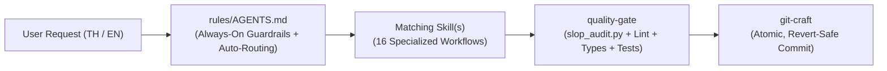

# 🛠️ Tinna Craft

[](./plugin.json)
[](https://github.com/tinarmon/tinna-craft)
[](./01_tinna-craft-manual.md)
[](./rules/AGENTS.md)

> **Turn your AI coding agent from a fast code generator into a disciplined engineering system.**  
> **Tinna Craft** is an Antigravity plugin bundling **16 specialized skills**, **always-on anti-slop guardrails**, and **deterministic verification scripts** — with **proactive auto-routing** so the agent picks the right skill automatically, even when you forget it exists.

---

## 🎯 What Problem Does It Solve?

Default AI assistants write code quickly, but often leave behind *AI slop*: over-engineered wrappers, silent error fallbacks, cross-module spaghetti, unverified claims, and bloated docs.

**Tinna Craft** fixes this at the root without manual prompting every session:

- **Proactive Auto-Routing:** You don't need to memorize skill names. `rules/AGENTS.md` automatically maps your natural-language request (Thai or English) to the matching skill.
- **Anti-Slop & YAGNI Discipline:** Enforces *Ponytail* minimalism (least new code that solves the problem) and *Dune-style* feature-slice boundaries so workarounds don't spread organically.
- **Deterministic Verification:** Pairs AI review with fast, zero-dependency Python checks (`slop_audit.py`, `implant_skills.py`) before any task is marked complete.
- **Portable Across Workspaces:** Install once into Antigravity's global plugins folder (or sync per-workspace `.agents/`) and every project inherits the same engineering bar.

---

## ⚙️ How It Works



---

## 🧰 What's Inside (16 Skills + Global Rules)

### 1. Workflow, Spec & Token Control
| Skill | What It Does | Key Output / Script |
|---|---|---|
| [`spec-first`](./skills/spec-first/SKILL.md) | Scopes complex multi-step features before coding | `specs/YYYY-MM-DD-slug.md` + acceptance criteria |
| [`quality-gate`](./skills/quality-gate/SKILL.md) | Runs the Verification Pyramid & outer-loop diff audit before saying "done" | [`slop_audit.py`](./skills/quality-gate/scripts/slop_audit.py) |
| [`rtkcave-token`](./skills/rtkcave-token/SKILL.md) | Compresses CLI output (`rtk`) + terse Caveman responses to save 50–90% tokens | Active session mode |

### 2. Coding, UI & Testing
| Skill | What It Does | Key Output / Script |
|---|---|---|
| [`python-craft`](./skills/python-craft/SKILL.md) | Production Python CLI scaffolding (`pathlib`, `argparse`, `logging`) & 5-step debugging | Clean typed Python modules |
| [`frontend-ui-engineering`](./skills/frontend-ui-engineering/SKILL.md) | Accessible (WCAG 2.1 AA), responsive React / Next.js / Tailwind UIs | Production UI components |
| [`code-simplification`](./skills/code-simplification/SKILL.md) | Refactors nested/complex code for clarity while preserving exact behavior | Simpler diff, 0 behavior change |
| [`test-driven-development`](./skills/test-driven-development/SKILL.md) | Red-Green-Refactor workflow & reproduction tests (`pytest`, Vitest, Playwright) | Behavior-focused test suites |
| [`feature-test-tree`](./skills/feature-test-tree/SKILL.md) | Maps Feature → Sub-feature → Covered & Missing Test Cases | Mermaid + [`render_tree_html.py`](./skills/feature-test-tree/scripts/render_tree_html.py) |

### 3. Data, Knowledge Graph & Performance
| Skill | What It Does | Key Output / Script |
|---|---|---|
| [`data-craft`](./skills/data-craft/SKILL.md) | Zero-dump EDA profiling, immutable raw data rules, row-count audit logs | Schema & integrity checks |
| [`SpeedOptimizer`](./skills/SpeedOptimizer/SKILL.md) | 4-phase profiling (`cProfile`, `tracemalloc`), vectorization, RAM downcasting, local AI tuning | Benchmarked speedups |
| [`graphify`](./skills/graphify/SKILL.md) | Converts code, docs, and papers into a navigable knowledge graph | `graph.json`, HTML, `GRAPH_REPORT.md` |

### 4. Documentation & Directory Architecture
| Skill | What It Does | Key Output / Script |
|---|---|---|
| [`doc-craft`](./skills/doc-craft/SKILL.md) | Anti-AI-slop BLUF prose (TH/EN), Booktabs tables, Print-CSS PDFs, `0N_{name}` versioning | Clean reports, ADRs, READMEs |
| [`dir-craft`](./skills/dir-craft/SKILL.md) | Audits root sprawl, enforces Feature-Slice Isolation, updates imports, reindexes docs | [`reindex_docs.py`](./skills/dir-craft/scripts/reindex_docs.py) |

### 5. Security, Git & Setup
| Skill | What It Does | Key Output / Script |
|---|---|---|
| [`LocalAISecurity`](./skills/LocalAISecurity/SKILL.md) | Air-gap `127.0.0.1` binding, DLP secret redaction, `safetensors`/`weights_only=True`, LFI defense | Security guardrails |
| [`git-craft`](./skills/git-craft/SKILL.md) | Pre-commit secret screening, atomic & revert-safe Conventional Commits, `CHANGELOG.md` | Clean git history |
| [`skill-implanter`](./skills/skill-implanter/SKILL.md) | Validates frontmatter/links and syncs skills globally or to any `.agents/` workspace | [`implant_skills.py`](./skills/skill-implanter/scripts/implant_skills.py) |

---

## 🛡️ Always-On Guardrails (`rules/AGENTS.md`)

Every workspace using **Tinna Craft** automatically enforces five core rules:

1. **Ponytail Senior Dev Mode (YAGNI):** Solve the task with the least new code; no premature abstractions or speculative options; always state what was skipped and any remaining risks.
2. **Anti-Slop Architecture & Verification Pyramid:** No organic workarounds ("code is memory"), strict feature-slice isolation (import only via public entrypoints), state/runtime invariants, and outer-loop diff audits.
3. **Stack Standards:** Python 3.12+ (`uv`, `ruff`, `pyright`, `pytest`), C++20 (`cmake`, `clang-format`), and Web/Full-Stack (Next.js App Router, Node 20+, Tailwind, Prisma, Vitest, Playwright).
4. **Sequential Document Versioning (`0N_`):** Reports and deliverables use `01_`, `02_`, `0N_` instead of `_final_v2_edit` chaos.
5. **Proactive Auto-Routing:** Matches user intent to the Skill Routing Matrix automatically — no need to remember exact skill names.

---

## ⬇️ Installation & Quick Start

**Requirements:** Antigravity installed (opened at least once) and **Python 3.12+** for helper scripts.

### Option 1: Install as Global Antigravity Plugin (Recommended)
```powershell
git clone https://github.com/tinarmon/tinna-craft.git "$HOME\.gemini\config\plugins\tinna-craft"
```
Restart Antigravity after cloning so it loads the plugin and `rules/AGENTS.md`.

### Option 2: Validate & Implant into a Specific Workspace (`.agents/`)
```powershell
python .\tinna-craft\skills\skill-implanter\scripts\implant_skills.py --verify-only
python .\tinna-craft\skills\skill-implanter\scripts\implant_skills.py --workspace "C:\path\to\your\project"
```

### Run the Deterministic Slop Audit Manually
```powershell
python "$HOME\.gemini\config\plugins\tinna-craft\skills\quality-gate\scripts\slop_audit.py" --root . --diff
```

---

## 💬 Usage Examples

Just talk to your agent naturally — auto-routing handles the rest:

- *"Run the quality gate on my last change"* → triggers `quality-gate` + `slop_audit.py`
- *"Extract features and test case tree for this project"* → triggers `feature-test-tree`
- *"Profile this CSV without dumping it"* → triggers `data-craft`
- *"จัดระเบียบโฟลเดอร์โปรเจกต์นี้ให้เป็นสัดส่วน"* → triggers `dir-craft`
- *"ช่วยเขียน commit และอัปเดต changelog"* → triggers `git-craft`

---

## 📁 Repository Structure

```text
tinna-craft/
├── plugin.json                 # Antigravity plugin manifest & suggested prompts
├── README.md                   # Project overview & quickstart
├── 01_tinna-craft-manual.md    # Detailed user & troubleshooting manual
├── rules/
│   └── AGENTS.md               # Always-on global directives & auto-routing matrix
└── skills/                     # 16 modular skills (SKILL.md + scripts/ + references/)
```

---

## 🧪 Verification & Contributing

Before committing or opening a PR, run the built-in checks:

```powershell
python .\skills\skill-implanter\scripts\implant_skills.py --verify-only
python .\skills\quality-gate\scripts\slop_audit.py --self-test
python .\skills\quality-gate\scripts\slop_audit.py --root .
```

Created and maintained by [@tinarmon](https://github.com/tinarmon). Open an [Issue](https://github.com/tinarmon/tinna-craft/issues) or [Discussion](https://github.com/tinarmon/tinna-craft/discussions) for ideas or bug reports.
