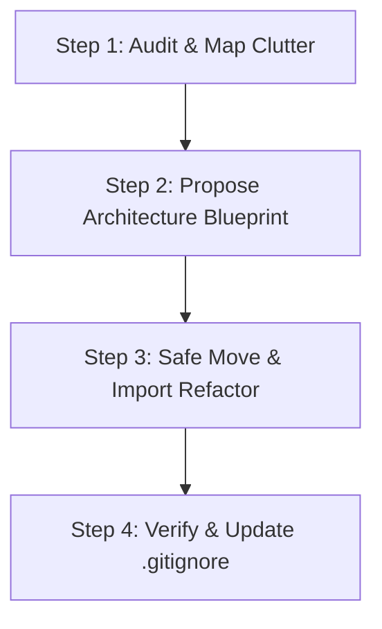

# Dir-Craft: Project Directory Structuring & Decluttering Engine

Use this skill whenever a project's directory structure is messy, scattered, has too many files in the root folder, or needs migration to a clean, standardized architectural layout (e.g. user says *"จัดระเบียบโฟลเดอร์"*, *"clean up directory"*, *"organize files"*, *"จัด directory"*, or *"reorganize project structure"*).

---

## 1. Core Operating Principles

1. **Audit First, Move Later:** Never move or rename files blindly. Always analyze file dependencies and present a Before/After tree blueprint for confirmation.
2. **Import Integrity:** Moving a file requires updating every import statement, path alias, and relative link that points to it.
3. **No Root Sprawl:** The repository root should strictly contain project-wide configuration files (e.g. `AGENTS.md`, `README.md`, `pyproject.toml`, `package.json`, `.gitignore`), never loose scripts, temporary data, or one-off tests.
4. **Standard Layering & Feature-Slice Isolation:** Group files by architectural role or self-contained feature slices (`features/<name>/` with explicit public entrypoints), never by arbitrary dumping grounds. Ban cross-feature internal imports so workarounds cannot spread organically.

---

## 2. The 4-Step Reorganization Protocol



### Step 1: Audit Current Directory Sprawl
Scan the current workspace to identify anti-patterns:
- **Root Bloat:** Scripts (`test.py`, `script.py`, `main.js`), notebooks, or data dumps sitting directly in the repository root.
- **Mixed Concerns:** Test files mixed randomly with production code (unless collocated by project design like `*.test.ts`).
- **Orphan / Scratch Files:** Unused scripts, untracked output logs, `.bak` or `.tmp` files.
- **Inconsistent Naming:** Mixed casing (`CamelCase` vs `kebab-case` vs `snake_case`) in directory or file names.

### Step 2: Propose Architecture Blueprint
Present a clear visual plan showing what will move and where:

```
[Current Layout]                     [Proposed Target Layout]
root/                                root/
├── main.py                          ├── src/
├── data.csv            ===>         │   └── my_package/
├── test_main.py                     │       └── main.py
├── run_experiment.sh                ├── data/
└── notes.md                         │   └── raw/data.csv
                                     ├── tests/
                                     │   └── test_main.py
                                     ├── scripts/
                                     │   └── run_experiment.sh
                                     └── docs/
                                         └── notes.md
```

### Step 3: Safe Relocation & Reference Updating
Execute the file reorganization using systematic steps:
1. **Create Target Directories:** Ensure target folders exist before moving.
2. **Relocate Files:** Move files to their dedicated functional zones.
3. **Document & PDF Versioning (`0N_{ชื่อเอกสาร}`):**
   - When reorganizing documents, reports, and PDFs, replace chaotic naming (`_final`, `_v2`, `_edit`, `แก้ครั้งที่2`) with the sequential prefix standard:
     - `01_{ชื่อเอกสาร}`: ฉบับร่างแรก / ฉบับเก่าสุด
     - `02_{ชื่อเอกสาร}`: ฉบับแก้ไขรอบถัดมา
     - `0N_{ชื่อเอกสาร}`: ฉบับล่าสุด / ฉบับสมบูรณ์ (โดยคง 2 หลัก `01`–`99`)
   - Preserve chronological sequence based on file creation / modified timestamps or semantic version notes.
   - Use the bundled helper script [reindex_docs.py](./scripts/reindex_docs.py) to preview (dry-run) and apply sequential reindexing automatically:
     ```powershell
     python ".agents/skills/dir-craft/scripts/reindex_docs.py" --dir ./docs
     python ".agents/skills/dir-craft/scripts/reindex_docs.py" --dir ./docs --apply
     ```
4. **Update References & Imports:**
   - **Python:** Update `sys.path`, absolute imports (`from src.pkg.module import ...`), and package `__init__.py`.
   - **JavaScript / TypeScript:** Update relative paths (`../`) or configure path aliases in `tsconfig.json` (`@/...`).
   - **Documentation & Markdown:** Update relative links (`[link](path/to/file)`).
   - **Scripts & CI:** Update file paths inside run scripts (`package.json` scripts, shell scripts, Makefiles).

### Step 4: Verification & Git Hygiene
1. Run automated test suites (`pytest`, `vitest`, `npm test`) to guarantee zero broken imports.
2. Ensure `.gitignore` covers build artifacts, virtual environments, caches, and OS files:
   - Python: `.venv/`, `__pycache__/`, `*.pyc`, `.pytest_cache/`, `dist/`
   - Node: `node_modules/`, `.next/`, `dist/`, `.turbo/`
   - General: `.DS_Store`, `Thumbs.db`, `*.tmp`, `*.log`, `.env`

---

## 3. Standard Architecture Templates

### Template A: Python / AI / Data Engineering
```text
project-root/
├── AGENTS.md                  # Workspace directives
├── README.md                  # Project overview & quickstart
├── pyproject.toml / uv.lock   # Dependencies & packaging
├── .gitignore
├── src/                       # Production library source code
│   └── <package_name>/
│       ├── __init__.py
│       ├── core/
│       └── utils/
├── scripts/                   # CLI tools, ETL entrypoints, training scripts
├── tests/                     # Unit and integration tests (mirrors src/)
│   ├── conftest.py
│   └── test_*.py
├── configs/                   # Experiment, model, or app config (YAML/TOML)
├── data/                      # (Ignored in git) Local datasets
│   ├── raw/
│   └── processed/
├── notebooks/                 # Exploratory Jupyter notebooks
└── docs/                      # Architectural docs, runbooks, ADRs
```

### Template B: Web & Full-Stack (Next.js / Node)
```text
project-root/
├── AGENTS.md
├── README.md
├── package.json
├── tsconfig.json
├── .gitignore
├── src/
│   ├── app/                   # Next.js App Router (pages, layouts, routes)
│   ├── components/            # Reusable UI components
│   │   ├── ui/                # Primitives (buttons, modals, inputs)
│   │   └── features/          # Domain-specific component groups
│   ├── lib/                   # Utilities, helpers, shared logic
│   ├── server/                # Server-only logic, actions, db queries
│   └── types/                 # Shared TypeScript interfaces & types
├── prisma/                    # ORM schema and migrations
├── public/                    # Static assets (images, fonts, favicons)
├── tests/                     # E2E & integration test suites
└── docs/                      # Architecture and API documentation
```

### Template C: Minimal / Tooling / CLI Utility
```text
project-root/
├── AGENTS.md
├── README.md
├── .gitignore
├── bin/ or scripts/           # Executable entrypoints
├── src/                       # Core implementation
├── tests/                     # Test cases
└── docs/                      # Usage guides
```

### Template D: Strict Feature-Slice Isolation (Anti-Slop / Dune Pattern)
Use when scaling multi-feature Python or TypeScript apps to prevent organic cross-module coupling:
```text
src/
└── features/
    ├── <feature_a>/
    │   ├── __init__.py / index.ts   # ONLY public API exposed outside this folder
    │   ├── service.py / service.ts  # Internal logic (banned from direct external import)
    │   └── test_feature_a.*         # Co-located or mirrored invariant & behavior tests
    └── <feature_b>/
        ├── __init__.py / index.ts
        └── ...
```
- **Boundary Rule:** External modules may import **only** from `features/<name>`'s public entrypoint (`__init__.py` or `index.ts`), never deep internal files. Enforce via `ruff` / `import-linter` / `eslint-plugin-boundaries` where available.

---

## 4. Safety Guardrails

- **NEVER** delete any file during reorganization without explicit user confirmation. Place obsolete files into an `_archive/` or `tmp/` folder instead of deleting directly.
- **NEVER** touch `.git/` or sensitive hidden tool folders (`.agents/`, `.gemini/`, `.vscode/`) unless specifically requested.
- **NEVER** move secrets or `.env` files into public, tracked directories.
